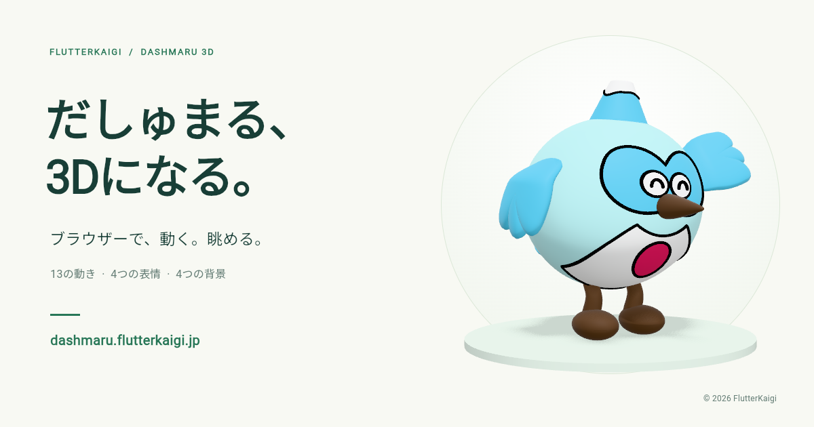

# だしゅまる3D Viewer

FlutterKaigiのキャラクター「だしゅまる」の3Dモデルビューアーです。
ブラウザーで動きや表情、背景を切り替えながら、好きな角度から眺められます。

[ビューアーを開く](https://dashmaru.flutterkaigi.jp/)

## 操作方法

| やりたいこと | 操作 |
| --- | --- |
| 動き・表情・背景を変える | 画面下のボタンで切り替え |
| 視点を変える | モデルをドラッグ、または「正面・横・後ろ」ボタン |
| 拡大・縮小 | モデル上でスクロール |
| 再生・一時停止 | 「再生／一時停止」ボタン、または `Space` |
| 再生速度を変える | 0.5×・1.0×・1.5×から選択 |
| 自動回転 | 視点ボタン横の回転アイコン |
| リセット | リセットボタン、または `R` |

## モデルのライセンス

モデルのうち、FlutterKaigiが権利を持つ独自部分は [CC BY-NC-ND 4.0](assets/models/LICENSE) です。
共有時はクレジットとライセンスの表記が必要です。営利目的の利用と、改変したモデルの共有はこのライセンスでは許可していません。

原Dashとの関係を含む詳しい条件は、[モデルの権利表記](assets/models/NOTICE.md)を確認してください。
ビューアーのコードは [MIT License](LICENSE) です。
